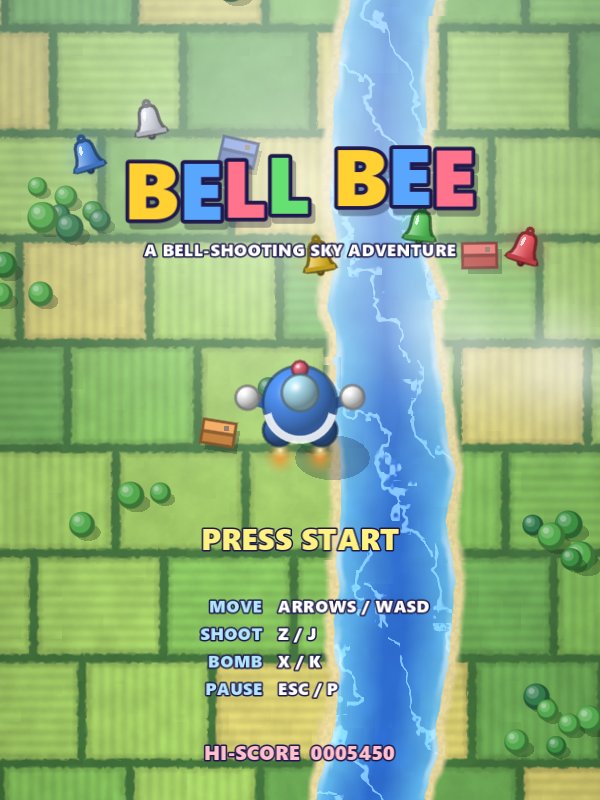
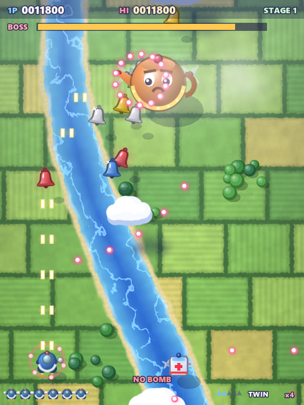
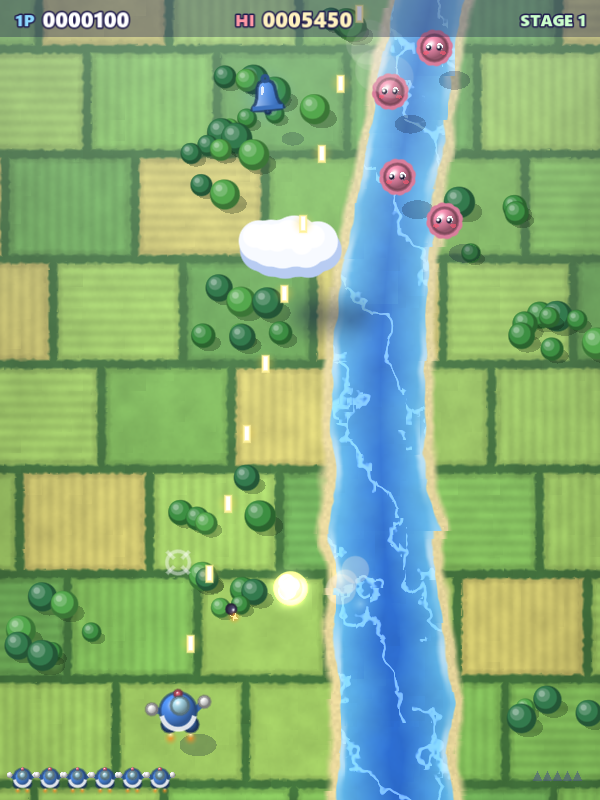
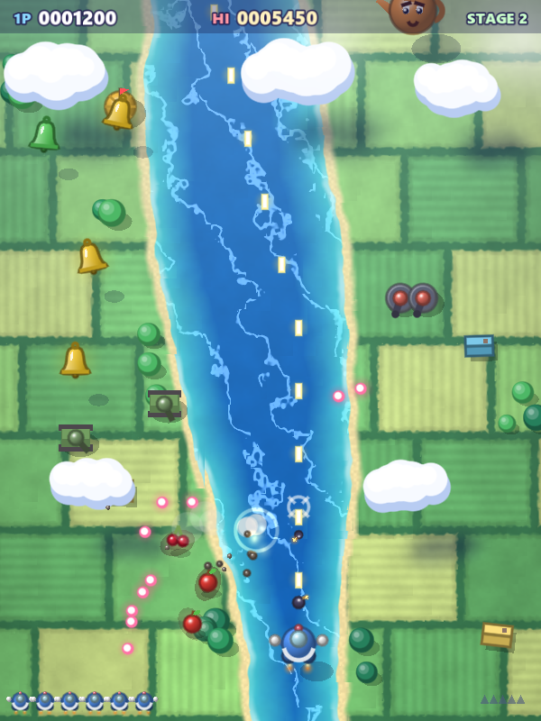
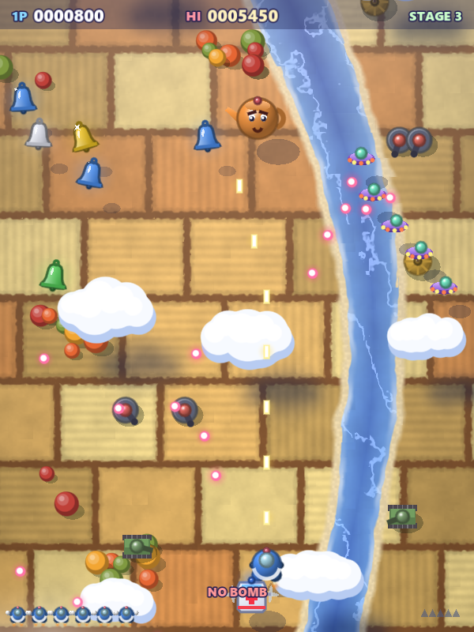

<div align="center">


# BellBee

**A cute vertical shoot 'em up about juggling bells in the sky.**
A personal tribute to Konami's *TwinBee* (1985), rebuilt from scratch in Godot.


### [▶ Play in your browser](https://mrjom1.github.io/bellbee/)

&nbsp;&nbsp;

</div>

---

## ✨ What is it?

BellBee is an arcade shmup where you fly a round little ship over a scrolling countryside, shoot what flies,
bomb what crawls, and keep **bells** bouncing in the air until they turn the colour you want.

- 🔔 **Bell juggling.** Shoot clouds to free bells, shoot bells to change their colour, catch them for power-ups
- 🎯 **Two weapons, two layers.** Shots hit flyers; bombs hit ground targets under the crosshair
- 🦾 **Arms you can lose.** Take a hit and an arm flies off. Catch the ambulance to get it back
- 🗺️ **3 stages + bosses**, each with its own look, then the game loops harder
- 🎨 **Everything drawn in code.** Shaders and vector shapes, no image files
- 🎵 **Original chiptune soundtrack**, synthesised at startup

<table>
  <tr>
    <td align="center"><br><b>Stage 1 · Meadow</b></td>
    <td align="center"><br><b>Stage 2 · Coast</b></td>
    <td align="center"><br><b>Stage 3 · Autumn</b></td>
  </tr>
</table>

---

## 🚀 Quick Start

### 🌐 In the browser

Open **[mrjom1.github.io/bellbee](https://mrjom1.github.io/bellbee/)**: no install needed. Click the game once so it gets keyboard focus.

- Desktop browsers with a keyboard or gamepad (Chrome, Edge, Firefox)
- Music fades in a few seconds after the title appears while it is generated
- Phones and tablets: not supported yet (no touch controls)

### 💻 On Windows

**Requirements:** [Godot 4.5.1](https://godotengine.org/download/archive/4.5.1-stable/) (standard, not .NET)

1. Clone the repo
   ```bash
   git clone https://github.com/Mrjom1/bellbee.git
   ```
2. Put the portable Godot 4.5.1 executables in `Tools/Godot_4.5.1/`
   (or keep the sibling `../Territory/Tools/Godot_4.5.1/` copy — `Play.bat` checks both)
3. Double-click **`Play.bat`**

> The Godot binary is not tracked in git.

---

## 🎮 Controls

| Action | Keyboard | Gamepad |
|---|---|---|
| Move | `←↑↓→` / `WASD` | D-pad / Left stick |
| Shoot (air) | `Z` / `J` — hold | `A` |
| Bomb (ground) | `X` / `K` — hold | `B` / `X` |
| Start / Continue | `Enter` / `Space` | `Start` |
| Pause | `Esc` / `P` | `Start` |
| Quit to title (paused) | `Q` | `Back` |

---

## 📜 Rules

### 🔔 Bells

Shoot a **cloud** to knock a bell loose. Each shot bounces the bell upward; every **5 hits** it changes colour.
Five more hits on a red bell **breaks** it, so don't overdo it.

| Bell | Power-up |
|:---:|---|
| 🟡 Yellow | Points. Catch yellows in a row: **500 → 1,000 → 2,000 → 4,000 → 6,000 → 8,000 → 10,000**. Dropping one or dying resets the chain |
| 🔵 Blue | **Speed up** (5 levels) |
| ⚪ White | **Twin shot** |
| 🟢 Green | **Option**: a ghost ship that follows and fires with you (max 2) |
| 🔴 Red | **Barrier**: absorbs 8 hits |

### 🦾 Arms & the ambulance

| State | Effect |
|---|---|
| Both arms | Everything works |
| One arm lost | ❌ No bombs |
| Both arms lost | ❌ No bombs, ❌ no twin shot. Next hit loses a life |

After you lose an arm, an 🚑 **ambulance** flies up from the bottom of the screen. Touch it to get both arms back.

### 🍒 Scoring extras

- **Huts** drop fruit when bombed. Fly over it: 500 → 1,000 → 2,000 → 3,000 → 5,000
- Wipe out a full **saucer formation**: +1,000 and a bell
- Big **kettles** always drop a bell
- **Extra life** at 30,000, then every 80,000
- Dying resets speed, twin shot, options and barrier

---

## 🛠️ Development

| | |
|---|---|
| Engine | Godot 4.5.1 · GL Compatibility renderer |
| Language | GDScript |
| Resolution | 480 × 640 internal, 600 × 800 window, scales to fit |
| Art | Runtime vector drawing + one ground shader |
| Audio | Synthesised SFX and music (`Audio` autoload) |

**Web build.** Every push to `main` runs [`.github/workflows/pages.yml`](.github/workflows/pages.yml), which exports the
single-threaded Web preset and deploys it to GitHub Pages. To build locally (needs the 4.5.1 export templates):

```bash
Godot_v4.5.1-stable_win64_console.exe --headless --path Game --export-release "Web" <abs path>/Builds/web/index.html
```

**Visual check.** A scripted pilot plays a stage and saves screenshots:

```bash
Godot_v4.5.1-stable_win64_console.exe --path Game res://Tests/capture.tscn -- <out_dir> <stage 0-2> <full|quick>
```

<details>
<summary><b>📁 Code map</b></summary>

| Path | Purpose |
|---|---|
| `Game/Scripts/Stage/stage.gd` | Scrolling, spawning, collisions, bells, arms/ambulance, death, boss, clear, continue |
| `Game/Scripts/Stage/stage_plan.gd` | Seeded spawn timeline per stage |
| `Game/Scripts/Stage/themes.gd` | Per-stage palettes and water layout (mirrors the shader) |
| `Game/Shaders/ground.gdshader` | Patchwork fields, river / coast, haze |
| `Game/Scripts/Stage/ground.gd` | Trees, houses and scorch marks over the shader |
| `Game/Scripts/Entities/` | Player, bells, clouds, air and ground enemies, boss, ambulance, fruit, projectiles |
| `Game/Scripts/UI/art.gd` | Shared drawing: shaded balls, ship, bell, glows |
| `Game/Scripts/Autoload/` | `Game` (run state, inputs, high score) · `Audio` (SFX and music) |

</details>

---

## 🗺️ Roadmap

- [x] Play in the browser (web export + GitHub Pages)
- [ ] Touch controls for phones
- [ ] 2-player co-op with ship combining
- [ ] More stages and bosses

---

## ⚖️ Disclaimer

Personal, non-commercial fan project. **TwinBee** is a trademark of Konami. BellBee is not affiliated with or
endorsed by Konami and uses none of its art, music or code. All assets are original.
